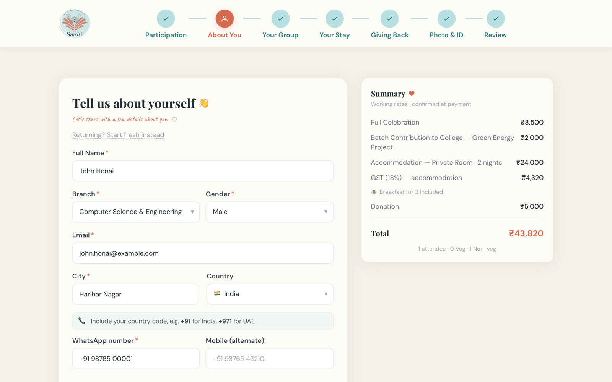
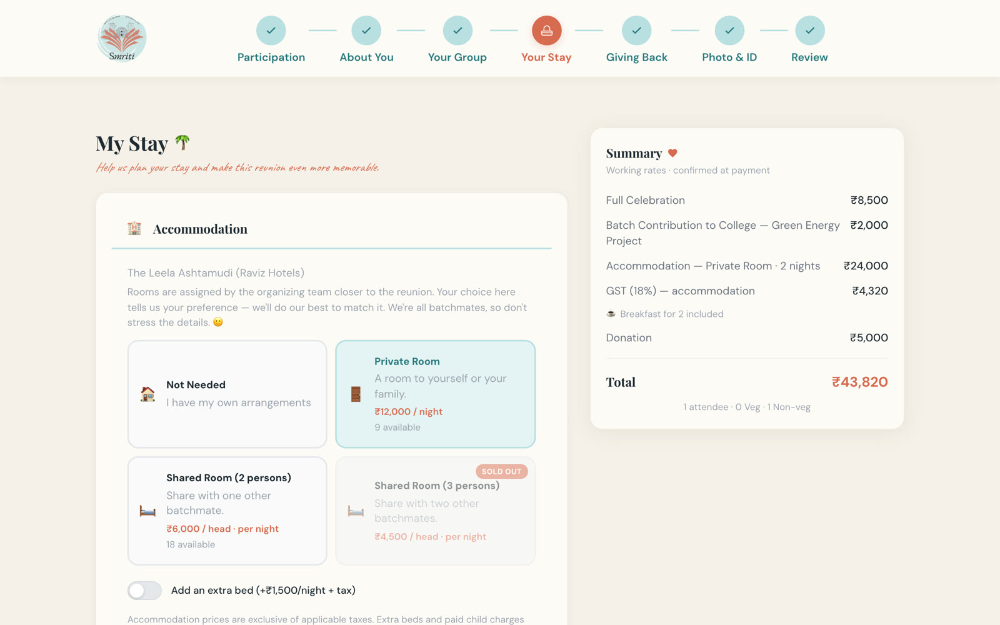
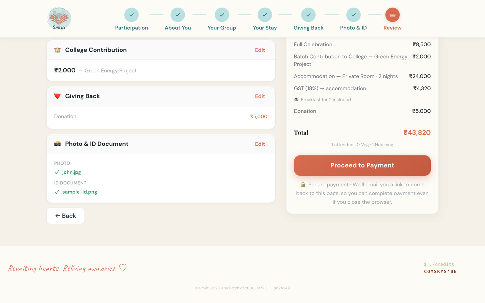
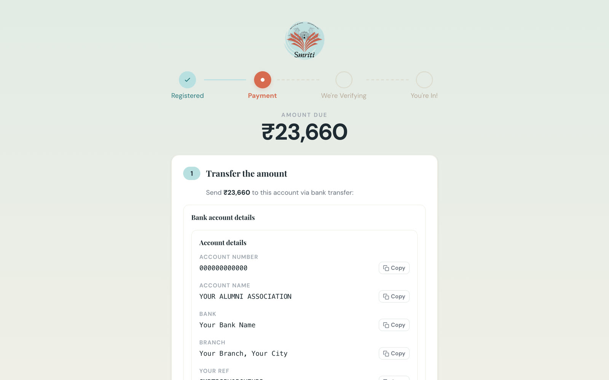
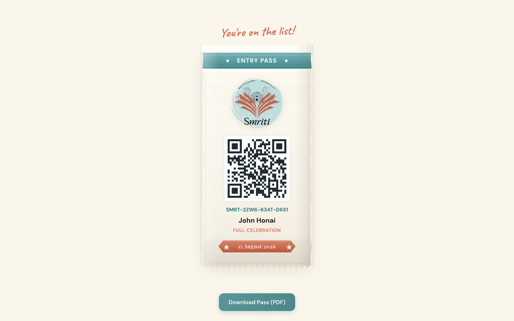
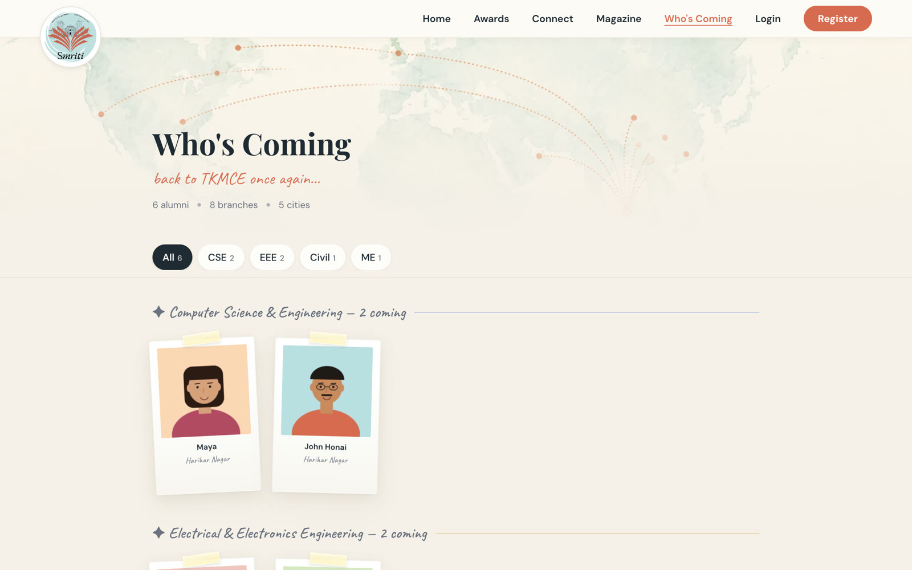
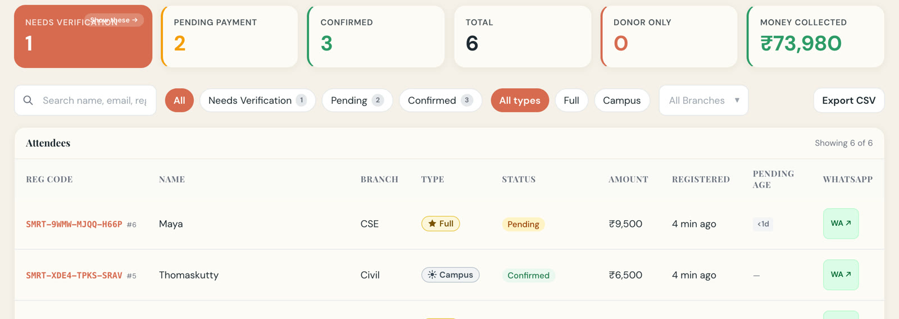
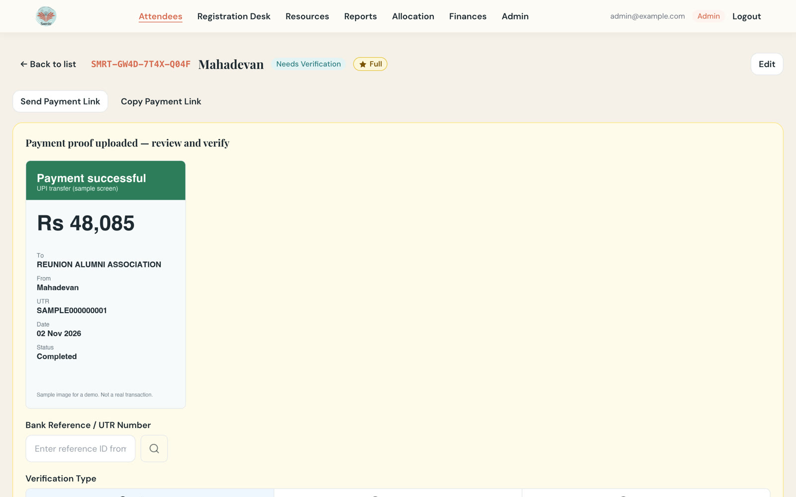
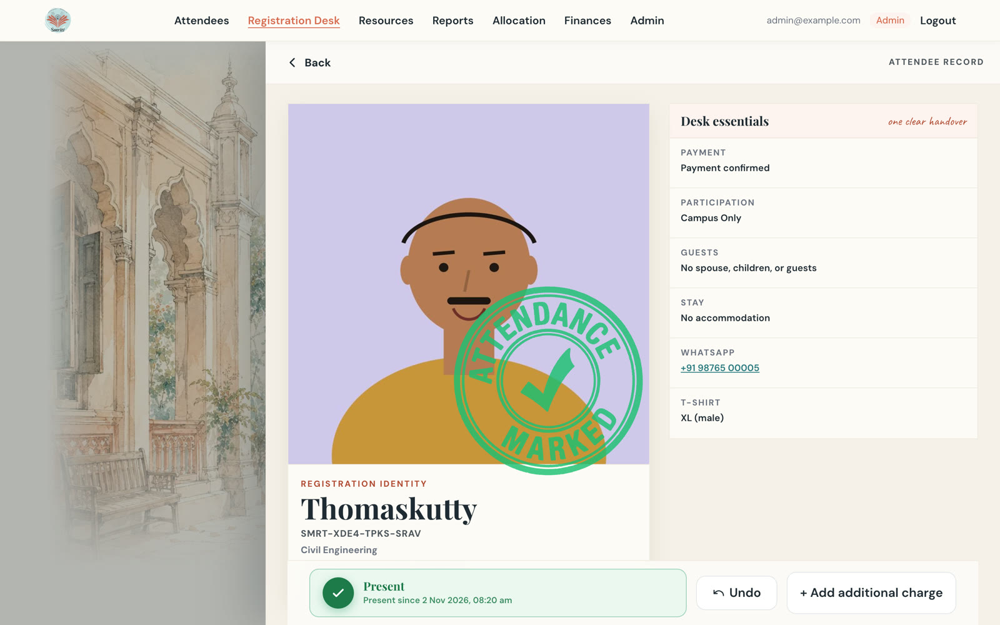
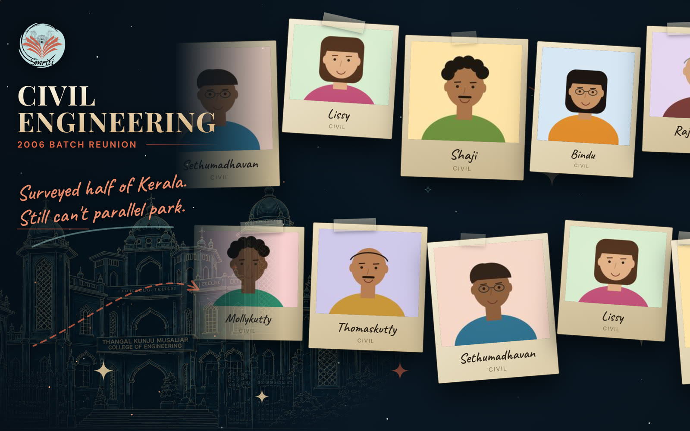

# Reunion Portal

A registration and event-operations portal for alumni reunions, built to be forked and adapted by the next batch. Alumni register, pay by bank or UPI transfer and get an entry pass. Organizers verify payments, assign rooms, run the check-in desk and show a live arrivals wall.

It was built and used for **Smriti 2026**, the TKMCE (TKM College of Engineering, Kollam) Class of 2006 reunion, held in August 2026. This repository keeps the Smriti branding, copy, prices and dates as a **working example**. Private values (infrastructure IDs, bank details, people, photos) are replaced with placeholders such as `REPLACE_WITH_*`, `YOUR ALUMNI ASSOCIATION` and `admin@example.com`.

**To adapt it:** start with [Make it yours in your first hour](#make-it-yours-in-your-first-hour), then [MAKE-IT-YOURS.md](./MAKE-IT-YOURS.md). You do not need to be a developer, but you do need to run commands in a terminal or hand this repository to an AI coding agent (see [AI agent support](#ai-agent-support)). Words you may not know (D1, R2, Worker, UTR, scope) are defined in the [glossary](./docs/GLOSSARY.md).

## See it

https://github.com/user-attachments/assets/70836329-39a3-4702-a6b8-aac8059cb19f

A 73-second tour, silent with captions. The people in it are fictional (characters from the 1990 Malayalam film *In Harihar Nagar*, plus a few invented batchmates), registered on a local copy of this repository.

<details>
<summary>What the video shows, in text</summary>

The left side is an alumnus's phone; the right side is the committee's laptop. Captions, in order:

1. "One batch ran its whole reunion on this." John Honai's entry pass on a phone and the public Who's Coming page.
2. "John Honai registers in seven steps." His details, room choice and price review in the registration wizard.
3. "The committee sees him on the list." The staff attendee list.
4. "Mahadevan uploads his bank-transfer receipt." His payment page after upload, and the receipt in the staff view.
5. "The treasurer checks the receipt and verifies." The bank reference is entered, Verify Payment is pressed, and his status becomes Confirmed.
6. "Confirmed. His entry pass is on his phone." His entry pass with a QR code; the dashboard's Confirmed count goes from 3 to 4 and Money collected from ₹73,980 to ₹1,22,065.
7. "Govindankutty and Appukuttan, matched as roommates." The room allocation page shows them matched.
8. "Rooms tracked per night." The room availability page: rooms per night and rooms occupied.
9. "Thomaskutty, found at the desk. One tap." On event day the desk searches "thom", opens his record and presses Confirm attendance.
10. "A few seconds later, on the hall's wall." His photo appears on the LED wall in the Civil Engineering scene. (The wall checks for new arrivals every 3 seconds.)
11. "After: the autograph book and awards." The after-event pages.
12. `github.com/madaboutcode/reunion-portal`: "Fork it. Your developer or an AI agent makes it yours."

</details>

| | |
|---|---|
|  Registration wizard, step 2 of 7 |  Room choice with live availability |
|  Price breakdown before payment |  Bank-transfer instructions and receipt upload |
|  Entry pass with QR code |  Public "Who's coming" page |
|  Staff dashboard: payment status and money collected |  Treasurer verifies an uploaded receipt |
|  Event-day desk: attendance confirmed |  LED wall in the hall (it shows one branch at a time) |

All names, photos, phone numbers and receipts in these images are samples.

## What it does

**Before the event**
- Registration wizard at `/register`, 7 steps: participation type, alumni details, group and meals, accommodation, photo and ID, giving back, review and pay. The draft is saved in the browser.
- Price estimate from one config object (`PRICING_DEFAULTS`), checked again on the server at submit.
- Payment by bank transfer or UPI with a payment page, printable advice and proof upload. There is no payment gateway.
- Magic-link login. Email is the identity; there are no passwords.
- Staff console at `/staff/*`: dashboard, registration edit, payment verify and reject, refunds, bank statement import and matching, reports, resources, room inventory, archive, team and feature flags.
- Room allocation from roommate preferences, and physical room assignment by night.
- Public pages: home, "Who's coming", sponsor, connect, committee todo list (Google Sheet backed).

**On event day**
- Registration desk at `/staff/check-in`: search, check-in, desk payment, spot registration.
- Entry pass with a QR code (PDF and `/pass`).
- LED wall at `/led-wall`: full-screen display of arrivals.
- ID-card PDF tooling in `scripts/idcard-mailmerge`.

**After the event**
- Memory stories and autograph wall (`/memories/stories`), prediction contest pages (`/awards`, `/leaderboard`, `/predictions`), credits reel, magazine viewer (`/magazine`).
- Staff reports and a daily report.

## Prerequisites

Local development needs only the first two rows. Deploying needs the Cloudflare and Mailgun rows too.

| You need | Needed for | How to get it |
|---|---|---|
| Node 23.11.0 and npm | Everything | The version is in `.node-version`. Install [fnm](https://github.com/Schniz/fnm) or [nvm](https://github.com/nvm-sh/nvm), then run `fnm install` and `fnm use` (nvm: `nvm install` and `nvm use`) in the repository folder. npm comes with Node. `npm ci` may print an `EBADENGINE` warning for `eslint-visitor-keys@5.0.1` on Node 23.11.0. It is a warning only; the install and the tests work. |
| Network access on first run | Local development | `make dev` downloads the web fonts once. |
| `uv` | Every Python script, `make doctor` | Run `curl -LsSf https://astral.sh/uv/install.sh \| sh`, or follow the [uv install guide](https://docs.astral.sh/uv/getting-started/installation/). Check with `uv --version`. |
| Cloudflare account with a domain (zone) | Deploying | Create an account at [dash.cloudflare.com](https://dash.cloudflare.com). Add your domain and wait until its status is Active. Then log in the CLI once: `npx -w @smriti/server wrangler login`. Full steps: [docs/DEPLOYMENT.md](./docs/DEPLOYMENT.md). |
| Mailgun account with a verified sending domain | Any deployed site (login emails) | In Mailgun, add your sending domain and copy the DNS records it shows (SPF, DKIM and the others) into your Cloudflare DNS. Wait until Mailgun shows the domain as verified. Then create an API key. Without Mailgun nobody can log in on a deployed site. [Why](./SECURITY.md#email-is-required-in-production). |
| GitHub repository | Deploying through CI | Fork this repository. Deploys run from GitHub Actions. |
| Google service account (optional) | Prediction contest data, committee todo page, attendance sync | In the Google Cloud console, create a project, enable the Google Sheets API, create a service account and download its JSON key. Share each Google Sheet with the service account's email address (Editor for the committee todo sheet). Encode the key with `base64 < key.json` and use that as `GOOGLE_SA_KEY`. |
| `gh` (GitHub CLI, optional) | Checking deploy status | Install from [cli.github.com](https://cli.github.com) and run `gh auth login`. |
| `agent-browser` (optional) | Only the browser smoke test in `scripts/ui/scenarios/` | See [agent-browser](https://github.com/vercel-labs/agent-browser). Not needed to run an event. |

## Quick start

1. Clone and install.

   ```bash
   git clone <your-fork-url> reunion-portal && cd reunion-portal
   fnm use            # or: nvm use. Reads .node-version.
   npm ci
   ```

2. Start the web app and the API.

   ```bash
   make dev
   ```

   The first run downloads fonts, creates `src/server/.dev.vars` from the example file (with local values), applies the database migrations to a local database, then starts the web app on port 5173 and the API on port 8787. If port 8787 is in use, `make dev` stops and tells you to pick another: `API_PORT=8788 make dev`. The web app follows the port you choose. Use the same port in the `curl` commands below.

3. In a second terminal, check the API.

   ```bash
   curl localhost:8787/api/health        # {"ok":true}
   ```

4. Log in as the first admin. Open `http://localhost:5173/login` and enter `admin@example.com`. The API terminal prints a line that starts with `Link: http://localhost:5173/auth/verify?token=...`. Open that link in the browser. It works once and expires after 10 minutes. You land on `/staff/dashboard` as admin.

   The API prints login links only for local development (`APP_BASE_URL` is `localhost`). On a deployed site it prints an error and no link.

5. Open registration. A fresh database has every feature flag off. In `/staff/config`, switch on `registration_show_page` and `registration_accept_new`. Then `/register` works.

Notes:
- `admin@example.com` is the first admin because migration `0003_users_and_auth.sql` inserts it. Change that email before the first remote migration (see [docs/DEPLOYMENT.md](./docs/DEPLOYMENT.md)).
- Shortcut that skips the login page: `curl -s -X POST localhost:8787/api/debug/magic-link -H 'content-type: application/json' -d '{"email":"admin@example.com"}'` returns a link in its `magicLink` field. This endpoint exists only in the local API.
- Reset the local database: delete `src/server/.wrangler/` and run `make db-migrate-local`.
- If `.dev.vars` is an older copy, it needs `APP_BASE_URL` (and `SENDER_NAME` once you add Mailgun keys). Without `APP_BASE_URL` every API request returns a 500 configuration error. Copy the lines from `src/server/.dev.vars.example`.

Before you commit, run `make check` (typecheck and lint) and `make test`. CI runs `make check` only. The full local loop, test data and the debug page are in [MAKE-IT-YOURS.md](./MAKE-IT-YOURS.md#8-local-development-loop).

## Make it yours in your first hour

The portal keeps names, URLs and infrastructure in two committed files, and secrets in files that git ignores. There are no feature switches in these files; features are changed in code (see [MAKE-IT-YOURS.md](./MAKE-IT-YOURS.md)).

1. **Fork** this repository and clone your fork.
2. **Edit `site.config.json`.** Set your event name, subtitle, title, sender name, GitHub repository, and for staging and production the site URL, CDN URL, thumbnails URL and Pages project name.
3. **Edit `src/server/wrangler.toml`.** Set your Cloudflare account ID, Worker names, route hosts, D1 database names and IDs, and R2 bucket names. Create these resources first: [docs/DEPLOYMENT.md](./docs/DEPLOYMENT.md), steps 2 and 3.
4. **Run `make doctor`.** It lists every value that still equals the Smriti example and checks that the two files agree. `make doctor-strict` fails while any example value is left; run it before launch.
5. **Rebrand.** Logo, colors, fonts, copy, emails, event facts, prices, payment details: [MAKE-IT-YOURS.md](./MAKE-IT-YOURS.md), sections 4 and 5.
6. **Deploy to staging.** `scripts/deploy.sh stg all --dry-run` shows what would happen. Then merge `main` into `release/stg` and push; CI deploys. Click through the site before you touch production.

Two files hold secrets and are never committed: `.env.ops` (operator tokens, copied from `.env.ops.example`) and `src/server/.dev.vars` (local development secrets). Which file owns which setting is in [AGENTS.md](./AGENTS.md#where-settings-live).

## Stack

| Layer | Technology |
|---|---|
| Web | React 19, Vite, TypeScript (strict), Tailwind CSS v4, React Router v7, React Hook Form + Zod |
| API | Hono on Cloudflare Workers |
| Data and files | Cloudflare D1 (SQLite), R2, Images binding (thumbnails) |
| Hosting | Cloudflare Pages (web) and Workers (API) |
| Email | Mailgun |
| Tests | Vitest in all three workspaces |

```
src/shared   @smriti/shared   types, pricing, validation, constants, feature-flag catalog
src/web      @smriti/portal   React SPA
src/server   @smriti/server   Hono API; migrations in src/server/migrations
docs/        specs (what each feature should do), guides
scripts/     ops scripts and tools (see ADMIN.md)
.claude/     skills and a workflow for AI-assisted operations
```

## Docs

| Document | Read it to |
|---|---|
| [MAKE-IT-YOURS.md](./MAKE-IT-YOURS.md) | Adapt the portal to your batch: config, features, branding, event facts, prompts for an AI agent |
| [ADMIN.md](./ADMIN.md) | Run the event: staff, payments, reconciliation, reports, desk day, rooms, ID cards, post-event |
| [docs/ARCHITECTURE.md](./docs/ARCHITECTURE.md) | Understand how the parts fit together and where the data lives |
| [docs/DEPLOYMENT.md](./docs/DEPLOYMENT.md) | Deploy from zero on Cloudflare |
| [CONTRIBUTING.md](./CONTRIBUTING.md) | Send a change upstream, or keep changes in your fork |
| [SECURITY.md](./SECURITY.md) | Report a vulnerability; know which files and data must stay private |
| [AGENTS.md](./AGENTS.md) | Orient an AI coding agent: layout, commands, rules |
| [.claude/skills/](./.claude/skills/devops/SKILL.md) | Skills for AI agents: `devops` and `payment-reconcile` |
| [docs/specs/](./docs/specs/README.md) | See what each feature should do (source of truth) |
| [docs/GLOSSARY.md](./docs/GLOSSARY.md) | Look up a term |

## AI agent support

Most adaptation work can be done by an AI coding agent such as Claude Code or Codex, with a human reviewing its plan and diffs.

- **[AGENTS.md](./AGENTS.md)** is the agent's entry point. It routes by task, names the file that owns each setting, lists the commands and states the rules (staging first, explicit environment, never commit secrets). `CLAUDE.md` points Claude Code to it.
- **Skills** in `.claude/skills/` load when the request matches their description:
  - `devops` loads for questions about production or staging, remote database queries, logs, login failures, deploys and CI. It wraps `d1-query`, `worker-logs`, `audit-log`, `ci` and `cf-token`.
  - `payment-reconcile` loads for a bank statement, "who paid", reconciliation, a partial payment, an overpayment, a refund or a rejected proof. It matches the statement to registrations and builds the status report.
- **Prompts** for rebranding, removing features and deploying are in [MAKE-IT-YOURS.md](./MAKE-IT-YOURS.md#7-example-prompts) and [ADMIN.md](./ADMIN.md#9-working-with-ai-for-ops).

Give the agent the narrow agent token only. Never give it the deploy token.

## Contributors

- Ajeesh Mohan
- Najaf Imdad
- Rahul Krishnan
- Aslam Abdulrahiman
- Ponnu A. Lekshmi: additional programming (prediction contest pages, home page, events pages)

## License

MIT. See [LICENSE](./LICENSE).
