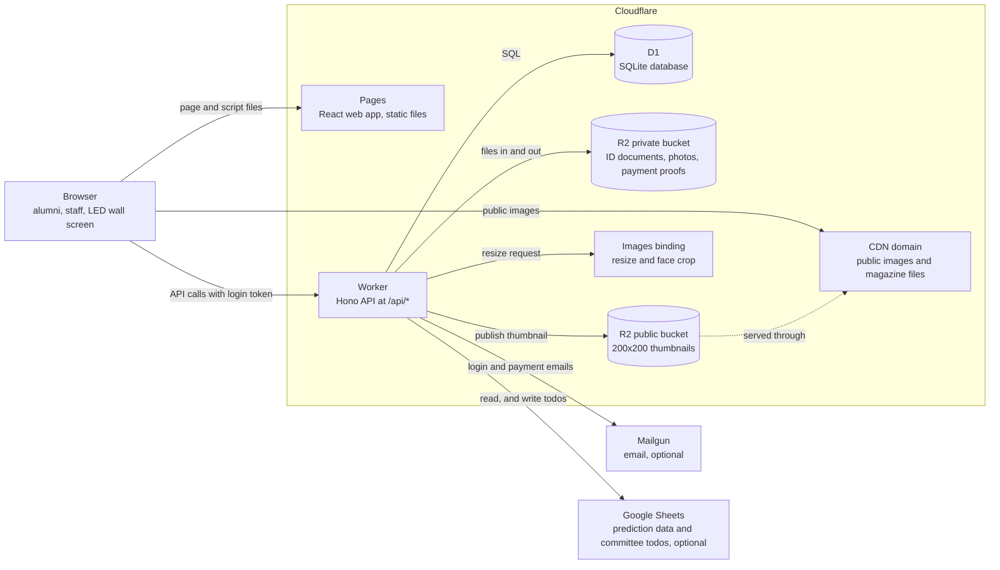
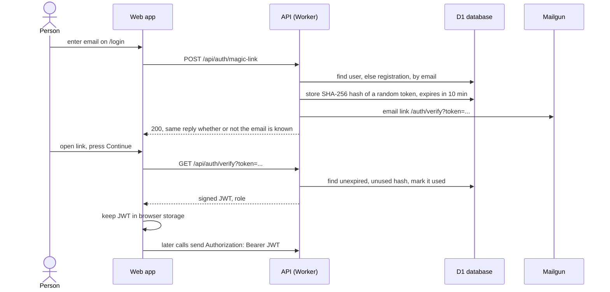
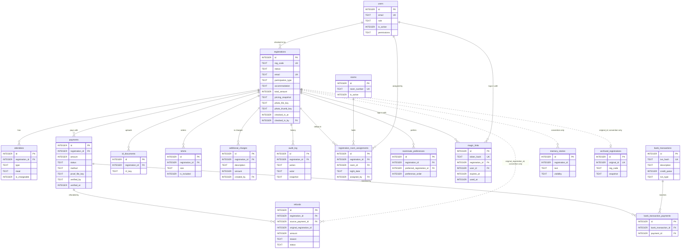
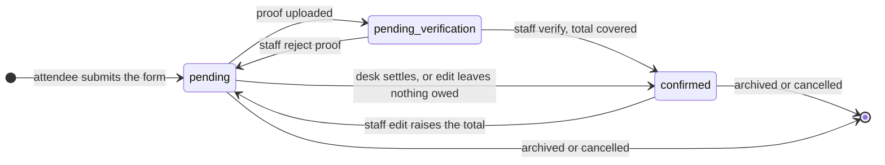
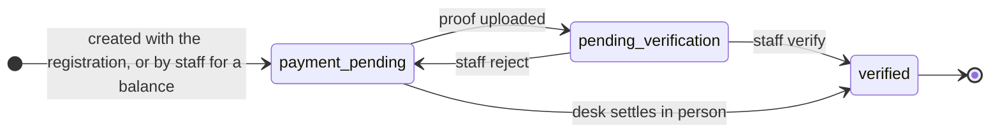
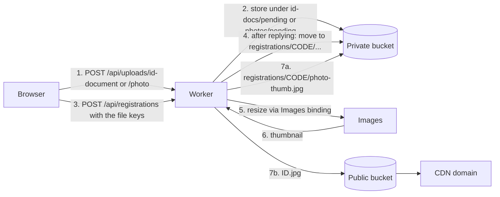

# Architecture

The portal is a React web app plus one API program, both hosted on Cloudflare. The web app shows pages and forms. The API checks every request, applies the rules (login, prices, payment states, who may see what) and stores data in a SQLite database. This guide explains how the parts fit together, so that you or an AI agent can change one part without breaking another.

Who this is for: organizers who read the code only a little, and the AI agents they hand the repository to. Skim sections 1 to 3 in about ten minutes. The later sections are reference: open the one that matches the change you plan.

## Four facts to know before you change anything

1. **The server decides the price, the status and who may do what.** The browser shows a price estimate and hides buttons, but it does not enforce anything. Every rule that matters is checked again in the API (sections 4, 6 and 7).
2. **A registration's status is calculated from its payments.** Nobody sets it freely. Staff verify or reject a payment, and the status follows (section 6).
3. **Payment status does not control the public "who's coming" list, the entry pass download or the LED wall.** Those depend on the participation type and, for the wall, on desk check-in. The desk refuses check-in while money is outstanding (section 6).
4. **Database migrations only go forward.** Never edit or delete a migration file that has already run on a real database (section 5).

## Terms used in this guide

More terms are in the [glossary](./GLOSSARY.md).

| Term | Meaning |
|---|---|
| Cloudflare Pages | Hosts the built web app as static files. |
| Worker | A small program that Cloudflare runs on demand. Here it is the API. |
| D1 | Cloudflare's SQLite database. |
| R2 | Cloudflare's file storage (like Amazon S3). A bucket is one storage space. |
| Cloudflare Images | A service the Worker calls to resize photos. |
| Binding | A named connection from the Worker to a Cloudflare resource, such as `DB` for D1. |
| Migration | A numbered SQL file that changes the database structure. |
| Magic link | A one-time login link sent by email. There are no passwords. |
| JWT | A signed login token. The browser keeps it and sends it with each API call. |
| Scope | A permission that unlocks one group of staff screens, such as `reports`. |
| Feature flag | An on/off switch stored in the database, so you can change behavior without a deploy. |

## 1. System overview

A visitor's browser loads the web app from Cloudflare Pages. The web app then calls the API at `/api/*` on the same site. The API reads and writes the database (D1), stores uploaded files in private storage (R2), and sends email through Mailgun. It can also read and write two Google Sheets, which are optional.



*Figure 1. Everything the browser does with data goes through the Worker. Dashed line: the public thumbnail bucket is reached by browsers through the CDN domain, not through the Worker. Solid lines to Mailgun and Google Sheets are used only when you configure them.*

What each piece does:

- **Pages** serves the web app. Any path that is not a file returns the app's `index.html`, and the app's router picks the page (`src/web/public/_redirects`).
- **Worker** is one Hono application. `src/server/src/app.ts` creates it, adds the `/api` prefix, wires the database, storage and email into every request, and mounts the route files.
- **D1** holds all structured data. Section 5 describes the tables.
- **R2** holds files. The private bucket is never public. The public bucket holds only thumbnails (section 9).
- **Mailgun** sends login links and payment emails. It is required on every deployed site. Without Mailgun settings only a local API prints the message to its log; a deployed Worker logs an error and no link, so nobody can log in (section 10).
- **Google Sheets** feeds the prediction contest pages and the committee todo page. Without Google settings those API routes are not mounted and return 404.
- **No payment gateway.** Attendees pay by bank or UPI transfer and upload proof. Staff check the proof (section 6).

## 2. Tech stack

Versions below are the installed versions from `package-lock.json`. The ranges in each `package.json` allow newer minor versions.

| Layer | Technology | Version | Why it is here |
|---|---|---|---|
| Runtime | Node.js | 23.11.0 (`.node-version`) | Runs the build, tests and local servers. CI reads the same file. |
| Language | TypeScript, strict mode | 5.8.3 | One language for web, API and shared code. |
| Web framework | React | 19.2.6 | The pages and the registration wizard. |
| Web routing | React Router | 7.15.1 | Client-side pages and route guards. |
| Forms | React Hook Form + Zod | 7.76.0 + 3.25.76 | Form state and validation. Zod schemas are shared with the API. |
| Styling | Tailwind CSS v4 | 4.3.0 | Utility classes; theme tokens live in the web app's CSS. |
| Build | Vite, with a PWA plugin | 6.4.2, plugin 1.3.0 | Dev server and production build. The plugin makes the committee page installable and caches wall photos. |
| API framework | Hono | 4.12.19 | Routing and middleware on the Worker. |
| Login tokens | jose | 6.2.3 | Signs and checks JWTs. |
| PDF | pdf-lib + fontkit | 1.17.1 + 1.1.1 | Builds the entry pass PDF in the Worker. |
| QR codes | qrcode | 1.5.4 | QR on the pass. |
| Platform tool | wrangler | 4.92.0 | Local Worker, local database, migrations, deploys. |
| Hosting | Cloudflare Pages, Workers, D1, R2, Images | managed | See section 1. |
| Email | Mailgun (HTTP API) | managed | Login and payment emails. Optional. |
| Tests | Vitest (all three workspaces) + Testing Library and jsdom (web) | 3.2.4; jsdom 27.0.1 | Section 11. |
| Lint | ESLint with eslint-config-prettier | 9.39.4 | `make lint` runs ESLint only. Prettier 3.8.3 is installed as a formatter but is not part of `make check`. |
| Ops scripts | Python scripts run with `uv` | `requires-python >= 3.11` in the script headers | Reports, desk roster, room allocation, ID cards. `uv` installs each script's dependencies on demand. See [ADMIN.md](../ADMIN.md). |

The monorepo uses npm workspaces (`package.json`), so one `npm install` at the root installs all three workspaces.

## 3. Repository layout

```
src/shared    @smriti/shared   types, pricing, validation, constants, feature-flag catalog
src/web       @smriti/portal   React web app
src/server    @smriti/server   Hono API, migrations, API tests
docs/         specs, guides, decision notes
site.config.json   identity and per-environment URLs
scripts/      ops scripts, deploy script, dev launcher, config reader and doctor
.claude/      skills and a workflow for AI-assisted operations
```

The package names still say `smriti` from the original deployment. They are internal names; renaming them is optional.

| Path | What lives there |
|---|---|
| `src/shared/src/` | Code used by both the browser and the API. `pricing.ts` (price calculation), `constants.ts` (prices, branches, dates, payee), `registration-schema.ts` and `validation.ts` (Zod rules), `feature-flags.ts` (the flag catalog), `types.ts` and `api-types.ts` (data shapes), `reg-code.ts` (registration codes), `bank-description-parser.ts` (reads bank statement lines). It has no UI and no Cloudflare dependencies, and other workspaces import its source directly with no build step. |
| `src/web/src/` | `App.tsx` (all routes), `pages/` (one file per screen), `components/` (grouped by feature, such as `registration/`, `staff/`, `registration-desk/`, `led-wall/`), `lib/` (API client, auth helpers), `hooks/`, `context/` (wizard state). `src/web/public/` holds static files and the Pages `_redirects`. `src/web/site-templates/` holds the templates for `_headers`, `robots.txt` and `sitemap.xml`; the Vite build fills them from `site.config.json` into `dist/`. |
| `src/server/src/` | `routes/` (HTTP handlers, grouped by area), `services/` (business rules), `repositories/` (all SQL), `domain/` (types and the status rules in `status.ts`), `middleware/` (auth, scopes, rate limits, feature-flag checks), `infra/` (JWT, email, logging), `app.ts` (wiring). |
| `src/server/migrations/` | Numbered SQL files, `0000` to `0025`. The authoritative database history. |
| `src/server/src/db/schema.sql` | A test-only copy of the schema, loaded by the in-memory test database. It can lag behind the migrations; its header lists the known differences. Never deploy from it. |
| `docs/specs/` | One spec per feature: what it must do. [Index](./specs/README.md). Code comments cite spec rule numbers such as `R4.3`. |
| `docs/decisions/` | Short notes on past design decisions. |
| `site.config.json` | Event name, subtitle and title, sender name, GitHub repo, and per environment the site, CDN and thumbnails URLs and the Pages project name. Identity and URLs only, never feature switches. |
| `scripts/` | `deploy.sh`, `dev-all.mjs`, `assert-debug-excluded.sh`, `site_config.py` (reads the config files for every script) and `doctor.py` (`make doctor`), and Python tools for reports, desk rosters, room allocation, ID cards and bank statements. |
| `.claude/skills/` | Two skills for AI agents: `devops` (read remote data) and `payment-reconcile` (match bank statements). `.claude/workflows/` holds a statement-extraction script. |

Dependency direction: web and server both import `shared`; web and server never import each other. If a rule must hold in the browser and in the API (a price, a validation), it belongs in `shared`.

Server code is layered the same way in every area: a route reads the request and calls a service; the service applies rules and calls repositories; only repositories write SQL. Follow that when you add an endpoint.

## 4. Login, roles and permissions

### 4.1 Magic-link login

Everyone logs in the same way: enter an email, receive a link, click it. The API looks in the `users` table first (staff and admins), then in `registrations` (attendees). If the address is in both tables, the staff identity wins.



*Figure 2. The token itself is never stored, only its hash. The login link works once. The page waits for the Continue button press because email scanners open links automatically and would otherwise use up the token.*

Facts from the code (`src/server/src/services/auth.service.ts`, `src/server/src/infra/jwt.ts`):

| What | Value |
|---|---|
| Login link lifetime | 10 minutes, single use |
| Payment link lifetime (sent in payment emails) | 24 hours |
| Links per person | 3 per 10 minutes, then silently ignored |
| Attendee JWT lifetime | 90 days |
| Staff and admin JWT lifetime | 7 days |
| JWT signing | HS256, with the Worker secret `JWT_SECRET` |

Deactivating a staff account stops new logins. A token already issued keeps working until it expires (up to 7 days), because the API checks the signature and not the account flag (`docs/specs/user-management.spec.md` R3.2).

### 4.2 Roles

| Role | Stored in | What it can do |
|---|---|---|
| `attendee` | `registrations` (no `users` row) | Own registration, payment proof upload, own memory stories. The token's `sub` is the registration id. |
| `staff` | `users` | Staff screens, limited by scopes (4.3). |
| `admin` | `users` | Everything staff can do with no scope limits, plus staff accounts, feature flags and story moderation. |

The `users.role` column only allows `staff` and `admin`. The first admin is created by migration `src/server/migrations/0003_users_and_auth.sql`, which inserts a placeholder address. Change it before the first remote migration (see [MAKE-IT-YOURS.md](../MAKE-IT-YOURS.md)). Later staff accounts are created by an admin on the `/staff/team` page.

### 4.3 Staff scopes

A staff user's `users.permissions` column holds `{"scopes": [...]}`. `NULL` means full access. Admins skip scope checks. The API caches a user's scopes for 5 minutes, so a scope change can take that long to apply. The seven scopes (`src/server/src/routes/admin.routes.ts`, `docs/specs/access-control.spec.md`):

| Scope | Unlocks |
|---|---|
| `dashboard` | Attendee list and detail, edit, payment verify and reject, refunds, archive and cancel, ID document and proof file viewing, export. The largest scope: 27 API handlers. |
| `resources` | Event planning totals and room inventory per night. |
| `reports` | Committee analytics (branches, revenue, budget, timeline). |
| `allocation` | Roommate preferences, room allocation, physical room assignment, payment-link generation. |
| `admin-tools` | Thumbnail regeneration, public thumbnail sync, status reconciliation, daily report. |
| `bank_txns` | Bank statement import, listing, comments and linking to payments. |
| `registration_desk` | Event-day lookup, check-in, desk payment, spot registration. |

Two staff endpoints need no scope: `GET /api/staff/my-registration` and `GET /api/staff/me/permissions`. Admin-only endpoints (`/api/admin/*`: staff accounts, feature flags, story moderation) check the role, not a scope, so a staff user cannot gain them with any scope.

### 4.4 Where routes are protected

Protection exists in two places, and only the server one is real.

| Side | Mechanism | Purpose |
|---|---|---|
| Server | `authMiddleware` checks the JWT and returns 401. `requireRole(...)` and `requireScope(...)` return 403. They are applied per router or per handler in `src/server/src/routes/`. | Enforces access. |
| Web | `ProtectedRoute` (role) and `RequireScope` (scope), both in `src/web/src/components/staff/`, wrap the pages in `src/web/src/App.tsx`. | Redirects to `/login` or shows "Access denied". Convenience only. |

Some endpoints are public by design: submitting a registration, uploading files during registration, the public lists, feature-flag reads, and the pass PDF (the registration code in the URL acts as the credential). These are rate-limited in memory per Worker instance (`src/server/src/middleware/rate-limit.ts`; categories `upload`, `auth`, `mutation`, `query`, `photo`).

## 5. Data model

Source of this section: all 26 migrations were applied to a fresh local D1 database and the schema was read from the resulting SQLite file. That matters because migration `0021_registration_desk.sql` rebuilds eleven tables, so reading migration files one by one gives a wrong picture. The result is 21 application tables, plus `d1_migrations` (kept by wrangler) and two SQLite or Cloudflare internals.

To reproduce it yourself, run `npx wrangler d1 migrations apply DB --local --persist-to /tmp/some-folder` from `src/server`, then open the `.sqlite` file under that folder with `sqlite3` and run `.schema`.

Money columns hold whole rupees as integers, except the `*_paise` columns in the bank tables, which hold paise. Timestamps are integer milliseconds since 1970. Most flags are `0` or `1`.

### 5.1 Core tables and relationships



*Figure 3. Almost everything hangs off `registrations`. Solid lines are real foreign keys. Dotted lines are links by convention: the column holds a registration id, but the database does not enforce it. `refunds.registration_id` is a real key too; the dotted refund line is its detached copy `original_registration_id`, kept after the registration is gone. Tables not drawn: `room_inventory`, `feature_flags`, `system_audit_log`, `desk_idempotency` (no relationships worth drawing) and `d1_migrations`.*

Three relationships work differently from what you may expect:

- **`memory_stories.registration_id` is not a foreign key.** A story keeps its author's name and branch as plain text in the row.
- **Archive and cancellation delete the live registration.** Staff archive or cancel through the API. The API copies the registration and its child rows into one JSON `snapshot` in `archived_registrations`, then deletes the live rows. `archived_registrations.original_id` remembers the old id. Cancellation also creates refund rows that keep their own copy of the person's identity, so they survive the deletion.
- **`registrations.pricing_snapshot` is a stored copy** of the price breakdown at submit time. Editing prices in code does not change existing registrations. If you change a registration with SQL, this copy can go stale.

### 5.2 Table guide

Route groups below are the API areas in `src/server/src/routes/`: *registration* (`registration.routes.ts`, `payment.routes.ts`, `upload.routes.ts`), *staff* (`staff.routes.ts`), *desk* (`registration-desk.routes.ts`), *allocation* (`allocation.routes.ts`, `room-assignment.routes.ts`), *bank* (`bank-transaction.routes.ts`), *admin* (`admin.routes.ts`, `config.routes.ts`, `admin-memory-stories.routes.ts`), *auth* (`auth.routes.ts`), *public* (`public.routes.ts`, `pass.routes.ts`), *stories* (`memory-stories.routes.ts`).

#### Registrations and attendees

| Table | One row is | Key columns | Written by | Read by |
|---|---|---|---|---|
| `registrations` | One person's registration | `reg_code`, `status`, `email`, `participation_type`, `total_amount`, `checked_in_at` | registration (submit), staff (edit, create, archive), desk (spot registration, present and absent) | Almost every area; public lists read name, branch, photo only |
| `attendees` | A spouse, child or guest on a registration | `registration_id`, `type`, `meal`, `is_chargeable` | registration (submit), staff (edit) | staff detail and reports, pass (headcount) |
| `tshirts` | One shirt order | `registration_id`, `size`, `is_included` | registration (the included shirt), staff, desk (extra shirts) | staff, reports |
| `additional_charges` | An extra charge added by staff | `registration_id`, `description`, `amount` | staff, desk | staff detail, desk |
| `id_documents` | One uploaded ID file | `registration_id`, `r2_key` | registration (submit) | staff (file viewer) |

#### Payments and bank transactions

| Table | One row is | Key columns | Written by | Read by |
|---|---|---|---|---|
| `payments` | One amount a person owes or paid | `registration_id`, `amount`, `status`, `method`, `proof_file_key` | registration (initial row, proof upload), staff (verify, reject, balance), desk (settle), staff edit | staff, bank, registration (own status), desk |
| `refunds` | Money to return, or returned | `source_payment_id`, `amount`, `reason`, `status` | staff (overpayment on verify, cancel, mark completed) | staff (refund queue) |
| `bank_transactions` | One line of an imported bank statement | `txn_hash`, `credit_paise`, `txn_type`, `import_batch` | bank (import, comment) | bank |
| `bank_transaction_payments` | A link between a bank line and a payment | `bank_transaction_id`, `payment_id` | bank (link, unlink) | bank, staff (archive snapshot) |

#### Accommodation and rooms

| Table | One row is | Key columns | Written by | Read by |
|---|---|---|---|---|
| `room_inventory` | Number of rooms available on one night | `night_date`, `total_rooms` | staff (room inventory page) | registration (availability check), staff resources |
| `rooms` | One physical room | `room_number`, `is_active` | allocation (room assignment) | allocation, desk |
| `registration_room_assignments` | One person in one room for one night | `registration_id`, `room_id`, `night_date` | allocation | allocation, desk, reports |
| `roommate_preferences` | One ranked roommate wish (1 to 5) | `registration_id`, `preferred_registration_id`, `preference_order` | allocation | allocation |

#### Check-in and desk

Check-in has no table of its own. It is `registrations.checked_in_at` and `checked_in_by`, written by the desk routes.

| Table | One row is | Key columns | Written by | Read by |
|---|---|---|---|---|
| `desk_idempotency` | A saved reply to one desk spot-registration request | `actor_id`, `idem_key`, `fingerprint` | desk | desk (so a retried request does not create a second registration) |

#### Login and staff

| Table | One row is | Key columns | Written by | Read by |
|---|---|---|---|---|
| `users` | A staff or admin account | `email`, `role`, `is_active`, `permissions` | admin (accounts), migration `0003` (first admin) | auth, every scope check |
| `magic_links` | One login or payment link | `token_hash`, `registration_id` or `user_id` (exactly one), `expires_at`, `used_at` | auth, staff (payment links) | auth |

#### Feature flags, audit and archive

| Table | One row is | Key columns | Written by | Read by |
|---|---|---|---|---|
| `feature_flags` | An override for one flag | `name`, `enabled`, `updated_by` | admin (flag page); migration `0018` (`debug_tools` row) | public (flag values), flag checks in the API |
| `audit_log` | One change to one registration, with a full snapshot | `registration_id`, `action`, `actor`, `snapshot` | every registration-changing route | staff (registration history) |
| `system_audit_log` | One system event (login, flag change, file view, desk action). Append-only | `action`, `actor`, `target_type`, `details` | auth, admin, desk, bank, staff | flag admin page (flag changes); other entries only by SQL |
| `archived_registrations` | One archived or cancelled registration | `original_id`, `reg_code`, `snapshot`, `archived_by` | staff (archive, cancel) | staff (archived pages) |

#### Memory stories

| Table | One row is | Key columns | Written by | Read by |
|---|---|---|---|---|
| `memory_stories` | One story (up to three per person) | `registration_id`, `author_name`, `text`, `visibility` | stories (author write), admin (hide or show) | stories (public read, own list), admin (moderation) |

#### Other

`d1_migrations` is kept by wrangler. It records which migration files ran on this database. Do not write to it by hand.

**Never edit an applied migration.** A database that already ran a file will not re-run it, so an edited file makes a fresh database differ from the live one. To change the structure, add a new file with the next number. To remove a feature, keep its migrations. The rules, with the reasons, are in [MAKE-IT-YOURS.md, section 3.3](../MAKE-IT-YOURS.md#33-migrations-never-delete-or-edit-applied-ones).

## 6. Registration and payment lifecycle

### 6.1 States

A registration has one of three statuses. A payment has one of three statuses. The rules are in `src/server/src/domain/status.ts`.

The status of a registration is not set by hand. After each payment change the code recalculates it from the payments:

1. If verified payments add up to at least `total_amount`, the status is `confirmed`.
2. Otherwise, if any payment is `pending_verification`, the status is `pending_verification`.
3. Otherwise, the status is `pending`.



*Figure 4. Registration status. `confirmed` is not final: a staff edit that raises the total creates a new unpaid payment and moves the registration back to `pending`.*



*Figure 5. Payment status. `verified` is final. A rejected proof does not get a "rejected" state: the payment goes back to `payment_pending` and the attendee gets an email asking for a new proof. There is no `refunded` payment status; refunds are separate rows (see 6.3).*

### 6.2 What triggers each change

| Change | Triggered by | Where in code |
|---|---|---|
| Registration and first payment created | Attendee submits the wizard | `services/registration.service.ts`, `repositories/registration.repo.ts` |
| Payment to `pending_verification` | Attendee, or staff on their behalf, uploads proof | `services/payment.service.ts` (`uploadProof`), `routes/payment.routes.ts`, `routes/staff.routes.ts` |
| Payment to `verified` | Staff verify, entering the amount actually received | `services/payment.service.ts` (`verifyPayment`) |
| Payment back to `payment_pending` | Staff reject, with a comment | `services/payment.service.ts` (`rejectPayment`) |
| Payment to `verified` without proof | Desk staff collect the full balance in person (cash, UPI or bank transfer) | `services/registration-desk.service.ts` (`settleDeskPayment`) |
| Registration back to `pending` | Staff edit raises the total, so a new `payment_pending` row is created | `services/edit.service.ts` |
| Any status repaired | Staff run "reconcile statuses" in staff tools | `routes/staff.routes.ts` (`/reconcile-statuses`) |
| Row removed | Staff archive (only if no real money moved) or cancel (creates refunds) | `services/archive.service.ts`, `services/cancellation.service.ts` |

Special cases in `verifyPayment`:

- **Received more than expected:** the payment is verified for the expected amount and the excess becomes a `pending` row in `refunds`. Staff mark it `completed` after returning the money.
- **Received less than expected:** the payment is verified for the amount received, and staff can create a balance payment for the shortfall in the same step. The registration stays unconfirmed until verified payments cover the total.

A bank statement match changes no status. Linking a bank line to a payment writes a row to `bank_transaction_payments` and an audit entry, nothing more. In the web app, the verify screen links the chosen bank line after the verify call succeeds, and the link is best effort (`src/web/src/pages/RegistrationDetailPage.tsx`).

### 6.3 What each state unlocks

| Thing | Depends on | Checked |
|---|---|---|
| Public "who's coming" list | Participation type only (`full_celebration` or `campus_only`). Not payment status. | `routes/public.routes.ts` |
| Entry pass PDF | Any registration that is not donation-only. The server does not check payment status. | `routes/pass.routes.ts` |
| "My Pass" link in the menu | Status `confirmed`, and the flag `navigation_show_my_pass`. This is a display rule in the web app only. | `src/web/src/components/SiteNav.tsx` |
| Desk check-in | Nothing owed: `total_amount` minus verified payments must be 0, otherwise the API answers 409 `payment_required`. Staff can settle at the desk first. | `services/registration-desk.service.ts` |
| LED wall and desk roster | `checked_in_at` set, and participation type `full_celebration` or `campus_only`. | `routes/public.routes.ts`, `repositories/desk.repo.ts` |
| Room availability count | No status filter found in the availability code, so unpaid registrations hold rooms. | `services/availability.service.ts` (read, not tested) |
| "Payment confirmed" email | The moment a registration becomes `confirmed` (verify or desk settle). | `services/payment.service.ts`, `services/registration-desk.service.ts` |

Refund status is its own small cycle: `pending` to `completed`, and never back. Refunds come from an overpayment or from a cancellation (`refunds.reason`).

## 7. Pricing

Prices are constants in one file, `PRICING_DEFAULTS` in `src/shared/src/constants.ts`. The arithmetic is one function, `calculateTotal` in `src/shared/src/pricing.ts`. The browser and the API both import them from `shared`, so they use the same numbers and the same formula.

| | Browser | API |
|---|---|---|
| Role | Shows a live estimate while the person fills the wizard (`src/web/src/lib/pricing.ts` re-exports the shared function) | Calculates the real total when the form is submitted (`src/server/src/services/pricing.service.ts`) |
| Authority | None. A modified browser can send any number, so the API ignores it. | Final. The result is stored in `registrations.total_amount` and `pricing_snapshot`. |
| Desk | Same preview in the spot-registration panel | Desk requests may not carry a total; the schema rejects those fields |

`GET /api/config/pricing` returns the same defaults for clients that want them.

Changing a price means editing `PRICING_DEFAULTS` and deploying; there is no admin screen for it. Registrations already submitted keep their stored total. A few places repeat amounts as text and must be updated by hand (page metadata, cost notes, email text). See [MAKE-IT-YOURS.md, section 5.1](../MAKE-IT-YOURS.md#51-where-they-live) for the list and a search command.

## 8. Feature flags

A feature flag turns a behavior on or off without a deploy. The list of flags is fixed in code. Their current on/off values live in the database.

| Part | Where |
|---|---|
| Catalog: label, group, default, failure value, public or admin-only, where enforced | `FEATURE_FLAG_CATALOG` in `src/shared/src/feature-flags.ts` |
| Overrides | Table `feature_flags` (`name`, `enabled`) |
| Logic | `src/server/src/services/feature-flag.service.ts` |
| Public read | `GET /api/config/features`: public flags only, never cached |
| Admin read and change | `GET` and `PUT /api/admin/config/features`, admin role; the page is `/staff/config` |
| Server enforcement | `requireFeatureFlag` in `src/server/src/middleware/require-feature-flag.ts` |
| Browser use | `useFeatureFlag` hook in `src/web/src/hooks/` |

The nine flags:

| Flag | Controls | Enforced in |
|---|---|---|
| `registration_show_page` | Whether `/register` and `/new` show the form | web |
| `registration_accept_new` | Whether new submissions are accepted; the API answers 403 when off | web and API |
| `navigation_show_register` | Register button in the menu | web |
| `navigation_show_my_pass` | My Pass link in the menu | web |
| `navigation_show_stories` | Stories link in the menu | web |
| `homepage_show_memory_stories` | Stories preview on the home page | web |
| `memories_show_stories` | Public stories page and its read API | web and API |
| `memory_stories_accept_submissions` | Creating and editing stories | web and API |
| `debug_tools` | Debug pages, admin only (the flag is not public) | web and API |

How a value is decided:

- **Default off.** All nine flags default to off. A new deployment shows no registration form until an admin turns on the flags it needs ([ADMIN.md](../ADMIN.md), section 1.5).
- **Missing row means the default.** A flag with no row in `feature_flags` uses its catalog default. Rows are overrides only. A row for a name that is not in the catalog is ignored.
- **Database failure means the failure value.** If D1 cannot be read, every flag uses its `failureValue`, which is off for all nine. The public endpoint still answers 200.
- **Only changed values are saved.** Saving a value equal to the current one writes nothing and logs nothing. Each real change is written to `system_audit_log`.
- **One reading per request.** The API reads the flags once per request, so a flag cannot change halfway through a request.

To add a flag, add it to the catalog, read it where it should act, and add a test. You do not need a migration.

## 9. Files and images



*Figure 6. Uploads happen before the registration exists, under a `pending` prefix. The move to a per-registration folder and the thumbnail run after the reply, so a slow resize never fails a registration.*

Details (`src/server/src/routes/upload.routes.ts`, `src/server/src/services/registration.service.ts`, `src/server/src/services/photo-thumbnail.service.ts`):

- **Upload limits:** 5 MB. ID documents: JPEG, PNG or PDF. Photos: JPEG or PNG. Uploads need no login, because the person has no account yet; they are rate-limited.
- **Payment proofs** go to the private bucket at `registrations/CODE/proof-N.ext`.
- **Thumbnails** are 200 x 200 pixel JPEGs, cropped around the face, made by the Images binding. If the binding is missing, thumbnail creation does nothing and the registration still succeeds.
- **Moves are best effort.** If the move out of `pending` fails, the original key keeps working and the row keeps the old key.
- **Portraits for the LED wall** (`{id}.webp` under the portraits URL) are not created by the Worker. The API only builds their URLs. Producing them is outside this repository's app code.

Who can read what:

| Content | Who can read it | How |
|---|---|---|
| ID documents, original photos, payment proofs | Staff with `dashboard` scope | `GET /api/staff/files/*`, limited to an allow-list of key prefixes, each view recorded in `system_audit_log` |
| Photo at the desk | Staff with `registration_desk` scope | `GET /api/staff/desk/registrations/:id/photo` |
| Thumbnails | Anyone with the URL | Public bucket through the CDN domain. If no public URL is configured, the API serves them at `/api/public/photos/:id.jpg` for full-celebration and campus-only people. |

Thumbnail names are the registration number, so they can be guessed. This is read from the code, not tested.

Nothing signs URLs. `getSignedUrl` in `src/server/src/repositories/file-storage.ts` is a stub that throws.

## 10. Environments

| | Local | Staging | Production |
|---|---|---|---|
| Web | Vite dev server with hot reload | Pages, built with debug pages included | Pages, built without debug pages |
| API | `wrangler dev` using `src/server/src/index.dev.ts` | Worker using `src/server/src/index.ts` | Same entry as staging, deployed with `--env production` |
| Database | Local SQLite managed by wrangler | Remote D1 | Remote D1 |
| Files | Local R2 simulation | Remote R2 | Remote R2 |
| Email | Printed in the API terminal (local address only) unless Mailgun is configured | Mailgun, required | Mailgun, required |
| How it gets there | `make dev` | Push to branch `release/stg`, CI deploys | Push to branch `release/prod`, CI deploys |

### Configuration

Each setting has one owner file ([docs/DEPLOYMENT.md](./DEPLOYMENT.md) has the full table).

| File | Owns |
|---|---|
| `src/server/wrangler.toml` | Cloudflare infrastructure per environment: account, Worker names, routes, D1 and R2 names and IDs. It has no URL variables. |
| `site.config.json` | Names, and per environment the site, CDN and thumbnails URLs and the Pages project. |
| Worker secrets | `JWT_SECRET`, `MAILGUN_*`, `GOOGLE_*` on the deployed Worker. |
| `.env.ops` (git-ignored) | Secrets for scripts: the agent token and optional keys. |
| `src/server/.dev.vars` (git-ignored) | Local development values. |

`scripts/deploy.sh <stg|prod>` reads the first two files and deploys the Worker with `--var APP_BASE_URL`, `SENDER_NAME`, `PUBLIC_PORTRAITS_URL` and `PUBLIC_THUMBS_URL`. The Worker needs `APP_BASE_URL` for login and payment link addresses and as the one allowed browser origin (CORS). If it is missing, blank or not a URL, every `/api` request returns a 500 configuration error that names the variable, and the Worker logs the name. `SENDER_NAME` is required only when Mailgun is configured. The Worker has no fallback address, so a deploy that skips `deploy.sh` fails closed instead of sending links to a wrong host (`src/server/src/lib/site-config.ts`).

The web build reads `site.config.json` itself. The Vite mode `production` uses `environments.prod`, `staging` uses `environments.stg`, and `make dev` uses `http://localhost:5173`. The build fills canonical and Open Graph addresses, the Content-Security-Policy meta tag, `_headers`, `robots.txt` and `sitemap.xml`. The API's own Content-Security-Policy lists the origins of `PUBLIC_THUMBS_URL` and `PUBLIC_PORTRAITS_URL`.

`make doctor` lists example values that remain and checks that the files agree. `make doctor-strict` fails while any are left.

**Email without Mailgun.** `MockEmailService` sends nothing. When `APP_BASE_URL` is `localhost` or `127.0.0.1` it prints each message and its link to the log. On any other address it logs `email is not configured` and leaves the link out, because a login link works as a password and the log may be readable by others. So a deployed site needs Mailgun to have any login.

### Local development and debug pages

**Local development.** `make dev` runs `scripts/dev-all.mjs`. It downloads the fonts if missing, creates `src/server/.dev.vars` from the example if it does not exist, stops with a message if the API port is in use (`API_PORT` picks another), applies migrations to the local database, and starts the web server (port 5173) and the API (port 8787). Vite forwards `/api` calls to the API. To log in locally, request a link on `/login` and copy it from the API's output. Rate limits are off when the API runs in development mode.

**Debug pages and routes.** The routes are `/debug`, `/debug/confirmations`, `/debug/tools`, `/debug/staff`, `/debug/whos-coming`, `/debug/advice`, `/debug/led-wall` and `/debug/credits-export`. They render components in isolation and expose test tools. Four layers keep them away from production:

1. **Build.** `src/web/src/App.tsx` only includes the debug routes when `import.meta.env.DEV` is true or `VITE_ENABLE_DEBUG` is `'true'`. Vite removes the code from other builds. CI sets the variable to `true` for staging and `false` for production.
2. **CI check.** `scripts/assert-debug-excluded.sh` builds with the variable off and fails if debug code is in the output.
3. **Browser gate.** Where the code ships (staging), `DebugRouteGate` requires an admin login and the `debug_tools` flag. On a local dev server it is open.
4. **API.** The three debug endpoints under `/api/debug` are mounted only in `index.dev.ts`, so they are 404 in staging and production.

## 11. Testing

All tests use Vitest. Counts are approximate and change with every feature.

| Workspace | Command | Files | Tests | What it covers |
|---|---|---|---|---|
| `src/server` | `make test-server` | about 59 | about 1,450 | Routes and services against an in-memory SQLite database loaded from `src/server/src/db/schema.sql`: login, roles and scopes, payment transitions, cancellation and refunds, desk check-in, allocation, bank statement parsing, feature flags, stories. |
| `src/web` | `make test-web` | about 91 | about 930 | Components and the registration wizard in jsdom: validation, step rules, staff and desk screens. |
| `src/shared` | `make test-shared` | about 13 | about 430 | Pricing for each participation type and accommodation choice, validation, mapping, sanitizing. |

`make test` runs all three. Some Python tools have their own tests: `scripts/test_tshirt_report.py`, and the tests folders under `scripts/idcard-mailmerge/` and `scripts/imagegen/`.

Two limits to know:

- **CI runs `make check` only**, which is typecheck for web and server plus ESLint for the web app. Tests do not run in CI, so run `make test` before you merge to a release branch. Nothing blocks a deploy when tests fail.
- **Server tests run on a copy of the schema**, not on the migrations. A migration mistake can pass the tests. Check a new migration by applying all migrations to a scratch local database (section 5).

## 12. Where to go next

| You want to | Read |
|---|---|
| Understand what the portal does and start it | [README.md](../README.md) |
| Adapt it to your batch: flags, branding, event facts, prompts for an AI agent | [MAKE-IT-YOURS.md](../MAKE-IT-YOURS.md) |
| Run the event: staff, payments, reports, desk day | [ADMIN.md](../ADMIN.md) |
| Deploy on Cloudflare | [docs/DEPLOYMENT.md](./DEPLOYMENT.md) |
| Look up a term | [docs/GLOSSARY.md](./GLOSSARY.md) |
| Send a change upstream, or report a vulnerability | [CONTRIBUTING.md](../CONTRIBUTING.md), [SECURITY.md](../SECURITY.md) |
| See what each feature must do, with numbered rules | [docs/specs/](./specs/README.md) |
